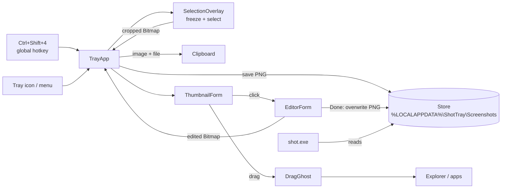
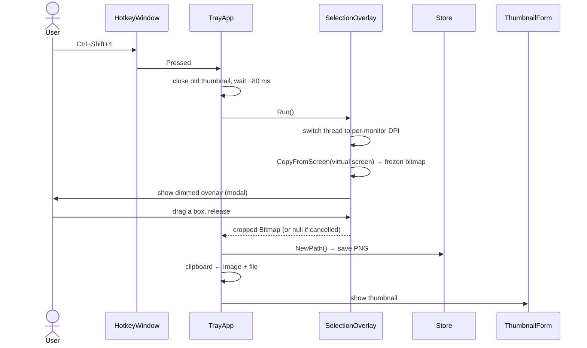
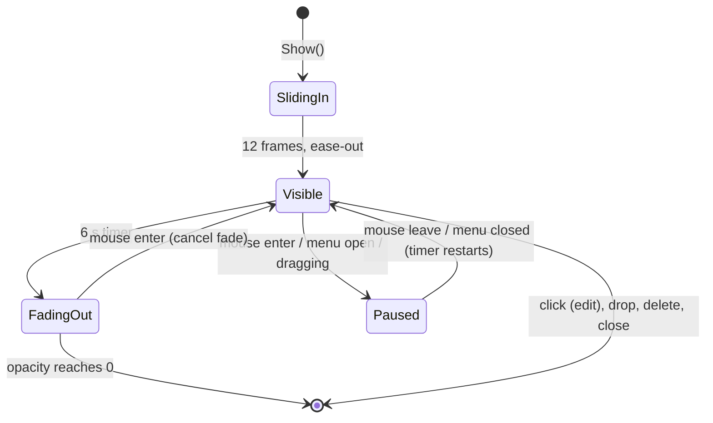
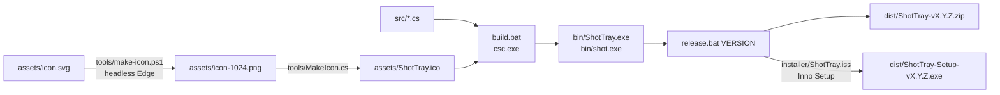

# Architecture

ShotTray is a small Windows Forms app written in C# 5. It compiles with the `csc.exe` that ships with .NET Framework 4.x, so no SDK, NuGet packages or other dependencies are needed. This document explains how the pieces fit together and why it's built the way it is.

## Contents

- [Overview](#overview)
- [Processes and binaries](#processes-and-binaries)
- [Components](#components)
- [Capture flow](#capture-flow)
- [DPI handling](#dpi-handling)
- [The thumbnail](#the-thumbnail)
- [Drag and drop](#drag-and-drop)
- [Markup editor](#markup-editor)
- [Storage and clean-up](#storage-and-clean-up)
- [Clipboard](#clipboard)
- [The `shot` CLI](#the-shot-cli)
- [Build and release pipeline](#build-and-release-pipeline)
- [Design decisions](#design-decisions)
- [Known limitations](#known-limitations)
- [Extending ShotTray](#extending-shottray)

## Overview

There is one long-running process, `ShotTray.exe`, which owns a tray icon and a global hotkey. Everything else is a window that exists only for as long as it's needed.

## Processes and binaries

| Binary | Type | Sources | Purpose |
|---|---|---|---|
| `ShotTray.exe` | WinForms app (`/target:winexe`) | everything in `src/` except `Cli.cs` | Tray app: hotkey, capture, thumbnail, editor |
| `shot.exe` | Console app (`/target:exe`) | `Cli.cs`, `Store.cs`, `AssemblyInfo.cs` | Prints screenshot paths for terminals |

The two binaries share only `Store.cs`, which knows where screenshots live and how they're named. They never talk to each other directly; the screenshots folder is the only shared state.

`ShotTray.exe` is single-instance. `Program.Main` takes a named mutex (`ShotTray.SingleInstance`) and exits quietly if another instance already holds it.

## Components

| File | Responsibility |
|---|---|
| `Program.cs` | Entry point. Single-instance guard, process DPI awareness, WinForms setup. |
| `TrayApp.cs` | `ApplicationContext` that lives for the whole session. Owns the tray icon, menu, hotkey, clean-up timer and the current thumbnail, and runs the capture flow. |
| `Native.cs` | Win32 interop: `RegisterHotKey`, DPI awareness switching, virtual-screen metrics. Also `HotkeyWindow`, a message-only window that receives `WM_HOTKEY`. |
| `SelectionOverlay.cs` | Full-screen modal form showing a frozen, dimmed snapshot of all monitors; the user drags a box, or clicks a highlighted window or monitor (`PickMode`). Returns the cropped `Bitmap` (and its physical screen rectangle) or `null`. |
| `CaptureBar.cs` | The `Ctrl+Shift+5` toolbar. A custom-painted form: mode buttons, Options menu, Capture/Record button. Raises `Chosen` with a `CaptureMode`. |
| `Recorder.cs` | Screen recording. A worker thread BitBlts the area into a DIB 30 times a second, draws the cursor and click highlights, and feeds the frames to a Media Foundation sink writer that encodes H.264 into an MP4. Also holds the minimal MF COM interop. |
| `RecordingUI.cs` | `Countdown` (timer), `RecordingBar` (elapsed time and stop button) and `RegionFrame` (red frame just outside a recorded portion). The last two are excluded from capture with `WDA_EXCLUDEFROMCAPTURE`. |
| `Settings.cs` | `CaptureMode` and the toolbar's remembered options (`HKCU\Software\ShotTray`). |
| `ThumbnailForm.cs` | Floating preview in the bottom-right corner: slide-in, 6 s life, fade-out, click/drag/right-click handling. |
| `DragGhost.cs` | Click-through picture of the thumbnail that follows the cursor during drag and drop. |
| `EditorForm.cs` | Markup window: toolbar, zoom-to-fit canvas, mouse handling, undo/redo, render and save. |
| `Shapes.cs` | Markup shape model (`StrokeShape`, `BoxShape`, `ArrowShape`, `TextShape`). |
| `Clip.cs` | Clipboard helpers with retry. |
| `Store.cs` | Screenshot folder, file naming, listing and 7-day clean-up. |
| `Cli.cs` | `shot` command. |
| `AssemblyInfo.cs` | Version and file details shown in Explorer. |

## Capture flow

Key points:

- **Freeze first, select second.** The whole virtual screen is captured *before* the overlay appears, so the overlay never ends up in the screenshot, and things like menus and tooltips stay frozen exactly as they were. The overlay just paints the frozen bitmap (dimmed outside the selection, full brightness inside it).
- **Old thumbnail out of the way.** If a thumbnail is still showing, it's closed and the app waits briefly (`Application.DoEvents` + `Thread.Sleep(80)`) so DWM removes it from the screen before the capture.
- **Re-entrancy.** A `capturing` flag ignores the hotkey while a capture is already in progress.
- **Tray-triggered captures** wait 200 ms so the closing tray menu isn't captured.
- **A click without a drag cancels** (selection smaller than 4×4 px), like macOS. `Esc` and right-click cancel too.

## DPI handling

Mixed-DPI multi-monitor setups are the trickiest part of screen capture on Windows. ShotTray uses two DPI modes on purpose:

| Context | DPI mode | Why |
|---|---|---|
| Whole process (`Program.Main`) | **System-aware** (`SetProcessDPIAware`) | WinForms menus, the thumbnail and the editor scale correctly with the system font size. |
| `SelectionOverlay.Run()` only | **Per-monitor v2**, set on the thread with `SetThreadDpiAwarenessContext` | Coordinates and pixels are physical on every monitor, so the capture is pixel-exact and the overlay covers all screens precisely. |

The thread's DPI context is switched before the overlay window is created and restored in a `finally` block after it closes. A window's DPI awareness is fixed when it's created, so the overlay is per-monitor aware while every other window stays system-aware.

On systems without `SetThreadDpiAwarenessContext` (older than Windows 10 1607), the call is skipped and capture falls back to system-aware behaviour.

## The thumbnail

`ThumbnailForm` is a borderless window with these extended styles:

- `WS_EX_NOACTIVATE`: showing or clicking it never steals focus from the app you're working in.
- `WS_EX_TOOLWINDOW`: not in Alt+Tab or the taskbar.
- `WS_EX_TOPMOST`: always on top. This is set through `CreateParams` rather than the `TopMost` property, because that property can activate the window.
- `CS_DROPSHADOW`: native shadow.

**Lifecycle**

A scaled preview is rendered once when the thumbnail is created (high-quality bicubic), so painting is cheap. Only one thumbnail exists at a time; `TrayApp` closes the previous one before showing a new one.

## Drag and drop

Dragging uses standard OLE drag and drop (`DoDragDrop`) with a `FileDrop` data object containing the screenshot path. Explorer, the Desktop, browsers, Discord, Slack, VS Code and others all accept that format.

- **Copy, not move.** Only `DragDropEffects.Copy` is offered, so the original stays in the screenshots folder and `shot` can still find it.
- **The ghost.** To make the thumbnail follow the cursor like on macOS:
  1. When the drag starts, the thumbnail renders itself into a bitmap (`DrawToBitmap`) and a `DragGhost` window shows that bitmap.
  2. The real thumbnail becomes invisible (`Opacity = 0`) but stays alive, because it's the drag source and owns the drag loop.
  3. `OnGiveFeedback` and `OnQueryContinueDrag`, which run repeatedly during the drag loop, move the ghost so it stays under the cursor at the point where it was grabbed.
  4. The ghost is `WS_EX_LAYERED | WS_EX_TRANSPARENT`, so hit-testing passes straight through it and drops land on the window underneath.
- **On drop:** the ghost and the thumbnail close.
- **On cancel** (Esc, or a target that refuses files): the ghost glides back to the corner over about 150 ms, then the thumbnail reappears and its 6-second timer restarts.

## Markup editor

Clicking the thumbnail raises `EditRequested`. `TrayApp` gives the editor its own **copy** of the bitmap (the thumbnail disposes its copy when it closes) and opens `EditorForm`.

**Model.** Shapes are stored in a `List<Shape>`, in **image pixel coordinates**, with a `Stack<Shape>` for redo. Every shape draws itself with `Draw(Graphics)`:

| Class | Tools |
|---|---|
| `StrokeShape` | Pen, Highlighter (same class, translucent colour and wider stroke) |
| `BoxShape` | Rectangle, Ellipse (`Ellipse` flag) |
| `ArrowShape` | Arrow (`AdjustableArrowCap`) |
| `TextShape` | Text (`Width` is the font size in image pixels) |

**View.** The canvas fits the image to the window (never upscaling) and keeps a cached, pre-scaled copy of the screenshot so repainting while drawing stays fast. Shapes are drawn on top with `TranslateTransform` + `ScaleTransform(zoom)`.

Because shapes are stored in image coordinates, **the same `Draw()` code renders the on-screen preview and the final full-resolution PNG.** Stroke widths and font sizes are converted from screen pixels to image pixels (`÷ zoom`) when a shape is created, so what you see is what gets saved.

**Text** is typed into a temporary borderless `TextBox` placed on the canvas. It's committed to a `TextShape` on Enter, on a click elsewhere, when switching tools or colours, or when focus is lost. Esc cancels it.

**Saving.** `Render()` draws the original image and all shapes into a new bitmap at full resolution.

- **Done** overwrites the screenshot file, puts the result on the clipboard, and hands the bitmap back to `TrayApp`, which shows a fresh thumbnail.
- **Copy** puts the result on the clipboard without closing.
- **Save as** writes a copy elsewhere.
- **Closing with unsaved shapes** asks for confirmation.

## Storage and clean-up

- **Folder:** `%LOCALAPPDATA%\ShotTray\Screenshots`
- **Names:** `shot_yyyy-MM-dd_HH-mm-ss.png`, with `_2`, `_3`, … added if several are taken in the same second. There are no spaces, so paths work unquoted in terminals.
- **Clean-up:** `Store.Cleanup()` deletes `shot_*.png` files whose last-write time is older than 7 days. It runs at startup and every 6 hours. Files that can't be deleted (locked, no permission) are skipped.
- Files dragged out or saved with **Save as** are copies elsewhere and are never touched.
- **Start with Windows** writes `HKCU\Software\Microsoft\Windows\CurrentVersion\Run\ShotTray`. No admin rights are needed.

## Clipboard

After each capture, the clipboard holds **two formats** at once:

| Format | Who uses it |
|---|---|
| Bitmap | Chat apps, editors, Office, Paint, Claude Code (`Alt+V`) |
| FileDrop (the PNG path) | Explorer: `Ctrl+V` pastes the file itself |

"Copy path" puts plain text on the clipboard instead. All clipboard writes go through `Clip.Set`, which retries 10 times, 100 ms apart, because another app may briefly have the clipboard locked.

## The `shot` CLI

`shot.exe` reads the same folder through `Store.Recent()`, which returns the newest files first.

| Command | Output | Exit code |
|---|---|---|
| `shot` / `shot last` | Path of the newest screenshot | 0, or 1 if there are none |
| `shot list [n]` | Up to `n` lines of `timestamp  path` | 0 |
| `shot dir` | Screenshots folder | 0 |
| `shot open` | Opens the folder in Explorer | 0 |
| anything else | Usage text | 2 |

The output is plain paths with no decoration, so it composes with other commands: `cp (shot) .\docs\`, `"$(shot)"`.

## Build and release pipeline

- **`build.bat`** finds `csc.exe` in `%WINDIR%\Microsoft.NET\Framework64\v4.0.30319` (falling back to 32-bit) and compiles both binaries.
  - `/win32icon` sets the icon Explorer shows for the exe.
  - `/resource` embeds the same `.ico` so `TrayApp.AppIcon` can load every size at runtime.
- **`release.bat VERSION`** checks that `src/AssemblyInfo.cs` says that version, builds, and zips both exes plus `README.md` and `LICENSE` into `dist/`. If Inno Setup 6 is installed, it then compiles `installer/ShotTray.iss` into `dist/ShotTray-Setup-vX.Y.Z.exe`.
- **`installer/ShotTray.iss`** makes a per-user installer (`PrivilegesRequired=lowest`), so no UAC prompt.
  - It uses the same `HKCU\...\Run\ShotTray` value as the tray toggle, so the two stay in sync.
  - `AppMutex=ShotTray.SingleInstance` matches `Program.cs`, so setup and the uninstaller detect a running copy and close it first.
  - Adding and removing the install folder on the user `PATH` is done in the script's `[Code]` section.
  - Keep `AppId` unchanged: Windows uses it to find the existing install when upgrading.
- **`tools/make-icon.ps1`** renders the SVG with headless Edge (with a transparent background), then builds the multi-size `.ico` with `tools/MakeIcon.cs`.
  - Sizes 16–128 are stored as 32-bit BMP frames, because .NET Framework's `Icon` class can't read PNG frames.
  - 256 is stored as PNG, as Windows expects.

**C# version.** The framework compiler only supports **C# 5**. That means no string interpolation (`$"..."`), no `?.`, no `nameof`, no expression-bodied members and no auto-property initialisers. See [CONTRIBUTING.md](CONTRIBUTING.md).

## Design decisions

| Decision | Why | Trade-off |
|---|---|---|
| WinForms + .NET Framework 4.x | Already on every Windows 10/11 PC; builds with no SDK; tiny output | Older UI stack, C# 5 only |
| Freeze the screen before selecting | Overlay never appears in the shot; transient UI (menus, tooltips) can be captured | Holds two full-desktop bitmaps in memory during selection |
| Per-monitor DPI only for the overlay | Pixel-exact capture without having to re-scale every WinForms window by hand | Two DPI modes in one process, which takes care to reason about |
| Always save to a folder | Nothing is lost if you ignore the thumbnail; the CLI always has something to return | Disk use, limited by the 7-day clean-up |
| Drag copies instead of moving | The temp copy stays available to `shot` and "Copy path" | Leaves a duplicate until clean-up |
| Shapes in image coordinates | One `Draw()` for screen and file; output is resolution-independent of the window size | Stroke widths are fixed when a shape is created |
| No network access | Privacy and trust; nothing to configure | No cloud upload or share links |

## Known limitations

- **Unsigned binaries.** SmartScreen warns on first run, and Smart App Control blocks the app entirely. Code signing is planned.
- **Fixed settings.** The hotkey (`Ctrl+Shift+4`), the 6-second thumbnail and the 7-day clean-up are constants in code.
- **One thumbnail at a time.** A new capture replaces the previous thumbnail; the file is still saved.
- **Protected content** (some DRM video, secure desktop prompts) shows up black, as with any `BitBlt`-based capture.
- **HDR displays** may capture with washed-out colours, because GDI capture is SDR.
- **16 px icon** is soft at 100% display scaling.
- **Shapes can't be moved or edited** after they're drawn; use undo instead.

## Extending ShotTray

**Adding a markup tool** (for example, blur):

1. Add a value to the `Tool` enum in `EditorForm.cs`.
2. Create a `Shape` subclass in `Shapes.cs` that implements `Draw(Graphics)` in image coordinates. A blur shape would need the source image as well, so pass it in when the shape is created.
3. In `EditorForm`:
   - add a toolbar icon in `ToolIcon` and register it with `AddTool`
   - create the shape in `OnCanvasMouseDown` and update it in `OnCanvasMouseMove`
   - add a keyboard shortcut in `ProcessCmdKey`
4. Document it in the README's Markup table.

**Adding a CLI command:** add a `case` to the `switch` in `Cli.cs`, update `PrintUsage()`, and add it to the README's CLI section.

**Making a constant configurable:** the candidates are `TrayApp.HotkeyText` together with the `HotkeyWindow` arguments, `ThumbnailForm.LifeMs` and `Store.KeepDays`. A settings file would naturally live next to the screenshots folder in `%LOCALAPPDATA%\ShotTray\`.
